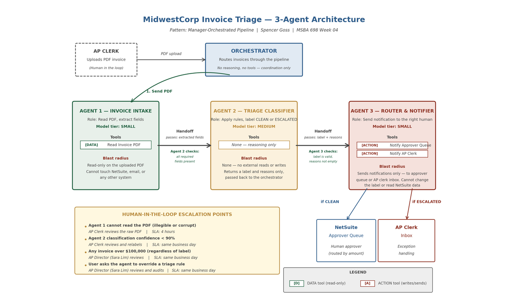
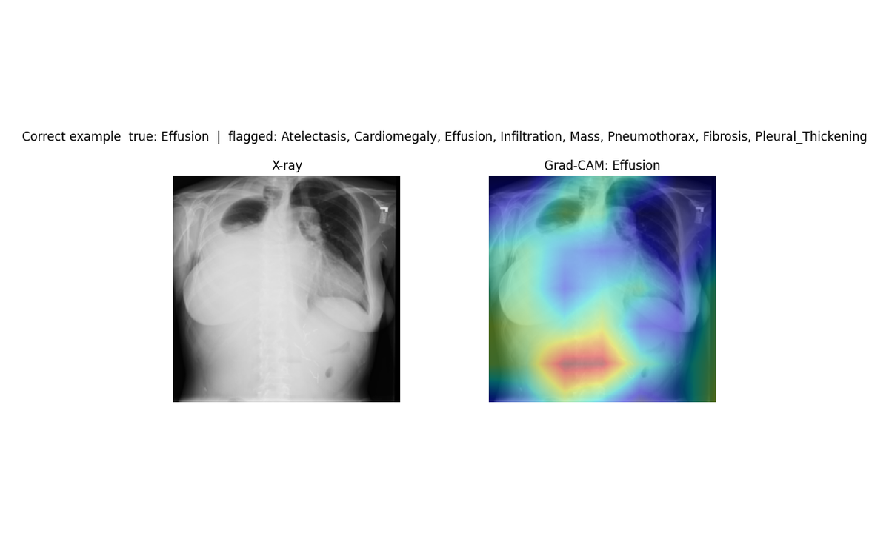
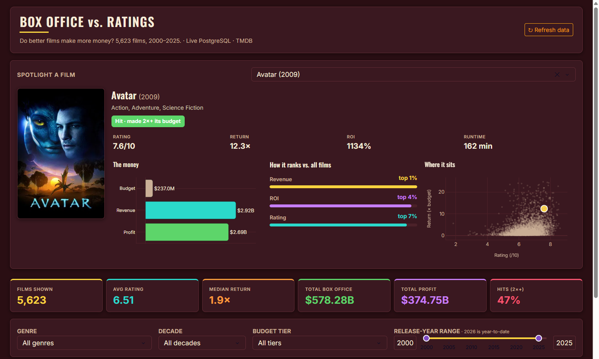
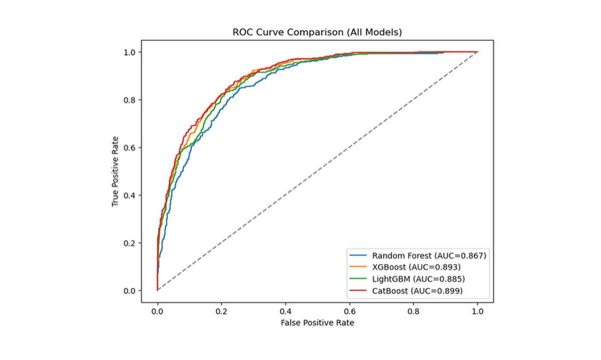

## Spencer Goss

M.S. Business Analytics, AI concentration (University of Louisville, 2026) · B.B.A. Finance & Marketing (University of Kentucky)

I build data products, predictive models and AI-assisted workflows, from the data pipeline through to the finished app.

[Portfolio](https://spencergoss.github.io) · [LinkedIn](https://linkedin.com/in/spencergoss1234) · Louisville, KY

---

### Featured: Oddsix

A multi-sport data and prediction platform covering the NBA, NFL, MLB, NHL and soccer: live scores, standings,
league overview pages, team and player pages for about 57,000 players, historical record books, daily trivia
games, and a prediction model for each sport. Data updates continuously through the day.

**[Live site](https://oddsix.app)** · **[Project tour](https://github.com/SpencerGoss/oddsix)** · Python, SQL, Astro, Cloudflare

---

### Projects

<table>
<tr>
<td width="50%" valign="top">

<h4><a href="https://github.com/SpencerGoss/invoice-triage-agent">Invoice Triage Agent</a></h4>
MSBA capstone. An AI agent workflow for accounts payable invoice intake in Microsoft Copilot Studio: three agents
read each invoice, check it against nine triage rules and route it to an approver or an AP clerk.
 Copilot Studio · prompt design · evaluation plan · NIST AI RMF
 <a href="https://github.com/SpencerGoss/invoice-triage-agent/blob/HEAD/docs/Agentic_Workflow_Playbook.pdf">Read the playbook</a> · <a href="https://github.com/SpencerGoss/invoice-triage-agent/tree/HEAD/prompts">See the prompts</a>
</td>
<td width="50%" valign="top">

<h4><a href="https://github.com/SpencerGoss/chest-xray-classifier">Chest X-ray Classifier</a></h4>
Deep-learning model that flags 14 conditions on chest X-rays (NIH ChestX-ray14). Eight models compared, Grad-CAM
heat maps that show where the model looked, and a web app.
 TensorFlow · transfer learning · scikit-learn · Streamlit
  · <a href="https://github.com/SpencerGoss/chest-xray-classifier#results-at-a-glance">Results</a>
</td>
</tr>
<tr>
<td width="50%" valign="top">

<h4><a href="https://github.com/SpencerGoss/box-office-vs-ratings">Box Office vs. Ratings</a></h4>
End-to-end pipeline that loads about 6,000 films from the TMDB API into PostgreSQL, with an interactive app on top
for exploring budgets, returns and ratings.
 Python ETL · PostgreSQL · Dash · Plotly
 <a href="https://box-office-vs-ratings.onrender.com">Live app</a> · <a href="https://github.com/SpencerGoss/box-office-vs-ratings/blob/HEAD/schema_documentation.md">Schema docs</a>
</td>
<td width="50%" valign="top">

<h4><a href="https://github.com/SpencerGoss/customer-churn-prediction">Customer Churn Prediction</a></h4>
Case-competition model on 5,636 customers. Four algorithms compared (CatBoost best, 0.899 AUC), SHAP driver
analysis and a three-segment retention plan.
 Python · CatBoost · XGBoost · LightGBM · SHAP
 <a href="https://github.com/SpencerGoss/customer-churn-prediction/blob/HEAD/ChurnCaseFinalModels.ipynb">Notebook</a> · <a href="https://github.com/SpencerGoss/churn-sql-database">SQL database</a>
</td>
</tr>
<tr>
<td colspan="2" valign="top">
<h4><a href="https://github.com/SpencerGoss/agent-engineering">agent-engineering</a></h4>
Patterns and reusable skills for running AI coding agents on real work: parallel workers, independent verification
of their output, and guardrails built from past errors. Works with Claude Code, Codex, Gemini CLI and Copilot.
 Prompt engineering · multi-agent workflows · 11 installable skills
</td>
</tr>
</table>

**More:** [churn-sql-database](https://github.com/SpencerGoss/churn-sql-database), a normalized SQLite schema for
the churn dataset with example queries, and [the original NBA data pipeline](https://github.com/SpencerGoss/foundation_nba_analytics_project)
that Oddsix grew from.

---

### Tools

Python (pandas, scikit-learn, LightGBM) · SQL (SQL Server, PostgreSQL) · Power BI · Tableau · Excel ·
Claude · Microsoft Copilot · Git · SAP · JD Edwards
